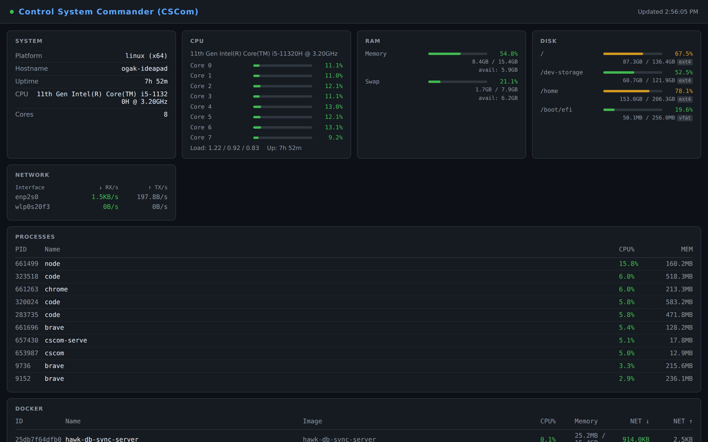
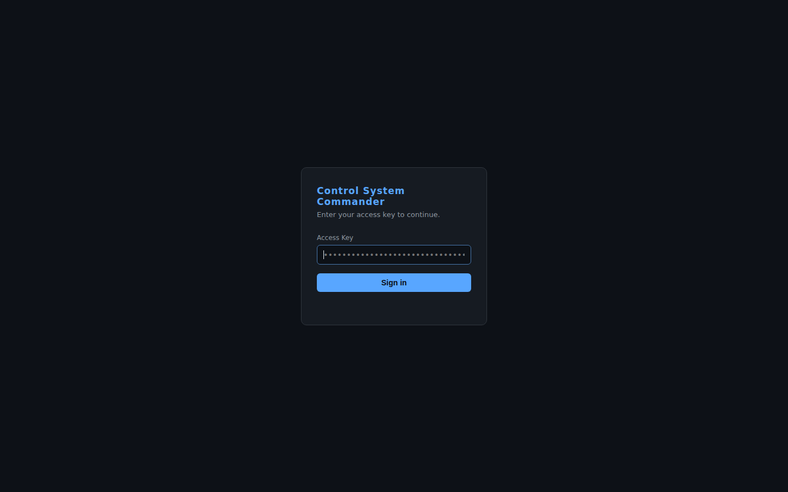
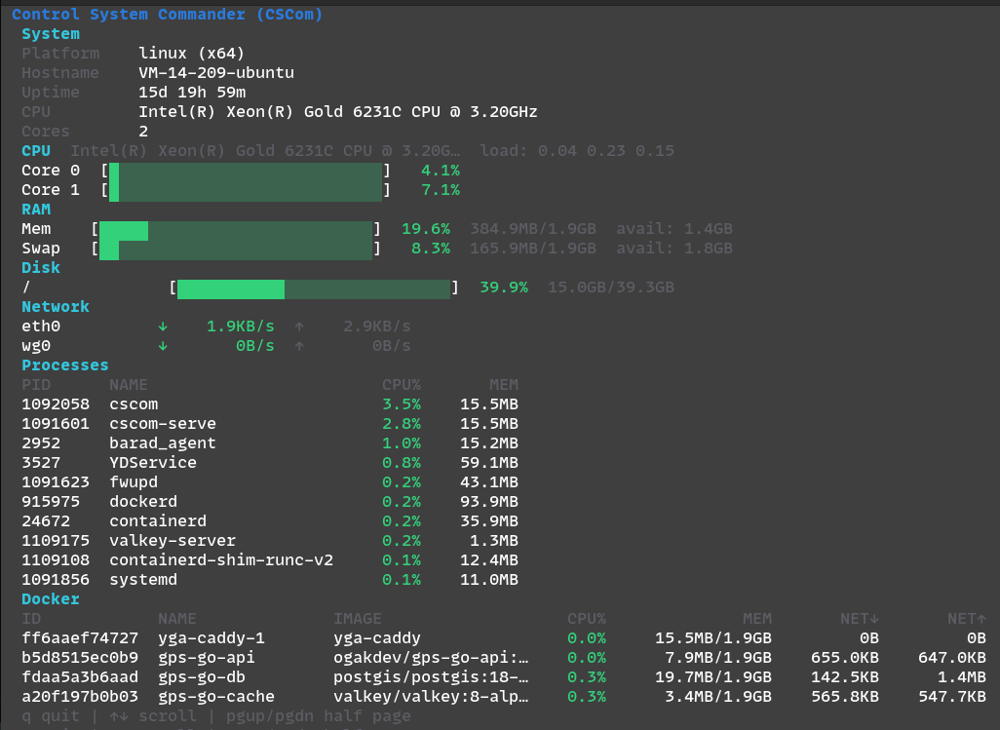

# Control System Commander (CSCom)
A lightweight system monitoring tool. CPU, RAM, GPU, Disk, Network, Docker, and Processes — two modes: TUI for local access, and a web dashboard with REST API + WebSocket for real-time data.

## Screenshots

### Web Dashboard


### Login Page


### TUI


## Features

- **CPU** — usage per core, load average, temperature, model info
- **RAM** — used/free/total with usage bar
- **Swap** — usage tracking
- **GPU** — utilization, memory, temperature (NVIDIA via `nvidia-smi`, AMD/Intel via sysfs)
- **Fans** — RPM per sensor (via hwmon)
- **Disk** — usage per mount point
- **Network** — RX/TX bytes, packets per interface
- **Processes** — top processes sorted by CPU usage
- **Docker** — container CPU%, memory, network I/O (auto-detect, hidden if no containers)

## Development

### Prerequisites

- Go 1.26.4+

### Run locally (without installing)

**TUI:**

```bash
go run ./cmd/cscom/
```

**Web server:**

```bash
go run ./cmd/cscom-serve/
```

**Build binaries:**

```bash
go build -o bin/cscom      ./cmd/cscom/
go build -o bin/cscom-serve ./cmd/cscom-serve/
```

---

## Deploy

Both local and remote deploy use the same script. By default it installs both the TUI and the web server; pass `--tui` to install only the TUI.

### Local machine

```bash
./install.sh local          # TUI + web server (dashboard + systemd service)
./install.sh local --tui    # TUI only
```

### Remote server

Setup `~/.ssh/config` first:

```
Host my-vps
    HostName 192.168.1.100
    User root
```

Then:

```bash
./install.sh my-vps
./install.sh my-vps --tui
```

The default (full) install will:
1. Use the existing `CSCOM_KEY` from `/opt/cscom/.env` if present, otherwise prompt to enter one
2. Build standalone binaries
3. Install to `/opt/cscom` + create systemd service
4. Start/restart the service

`--tui` skips all of that and just builds `cscom` and installs it to `/usr/local/bin`.

### Uninstall

```bash
./uninstall.sh local
./uninstall.sh my-vps
``` 

## Usage

### Terminal (TUI)

```bash
cscom
```

### Web Dashboard

The dashboard is served by the `cscom-serve` binary (managed by systemd):

- Dashboard: `http://<host>:4040`
- REST API: `http://<host>:4040/api/metrics`
- Version: `http://<host>:4040/api/version`
- WebSocket: `ws://<host>:4040/ws`

If `CSCOM_KEY` is set, the dashboard will show a login dialog on first visit.

## Configuration

| Variable | Default | Description |
|----------|---------|-------------|
| `PORT` | `4040` | Web server port |
| `CSCOM_KEY` | (empty) | API key. If empty, auth is disabled |

## Struktur Project

```
cscom/
├── cmd/
│   ├── cscom/
│   │   └── main.go              # Entry point — TUI
│   └── cscom-serve/
│       └── main.go              # Entry point — Web server
├── internal/
│   ├── metrics/
│   │   ├── collector.go         # Aggregates all metrics into a Snapshot
│   │   ├── system.go
│   │   ├── cpu.go
│   │   ├── ram.go
│   │   ├── disk.go
│   │   ├── network.go
│   │   ├── gpu.go
│   │   ├── fan.go
│   │   ├── docker.go
│   │   └── processes.go
│   ├── transport/
│   │   ├── server.go            # HTTP / REST API / WebSocket
│   │   └── auth.go              # Session store, auth middleware, login/logout
│   └── tui/
│       ├── model.go             # Bubble Tea model — state + update loop
│       └── view.go              # Terminal rendering
├── web/
│   ├── index.html               # Dashboard frontend
│   └── login.html               # Login page
├── install.sh
├── uninstall.sh
├── release.sh                   # Builds the TUI binary for a GitHub release
├── go.mod
├── go.sum
└── .env.example
```